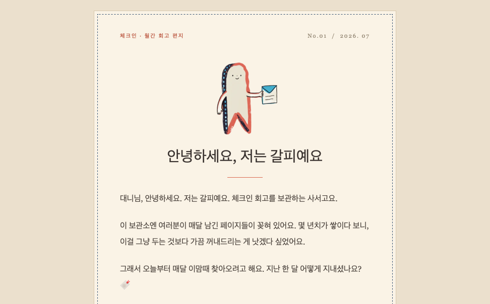
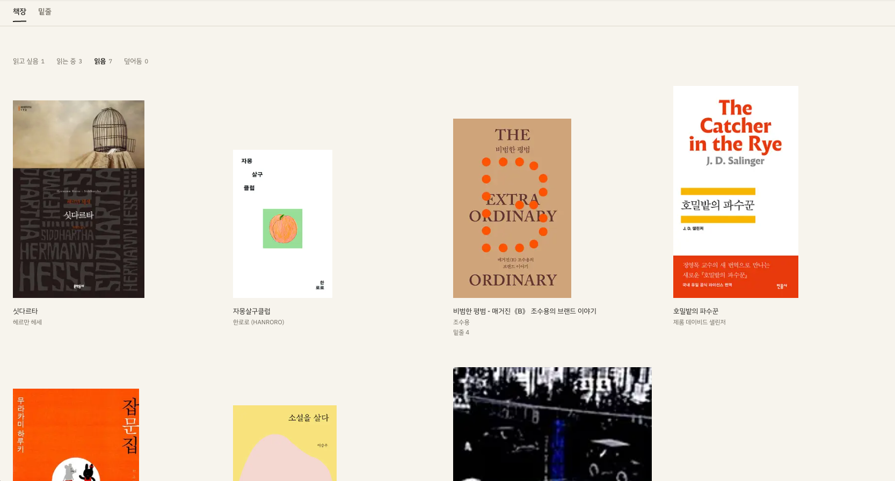
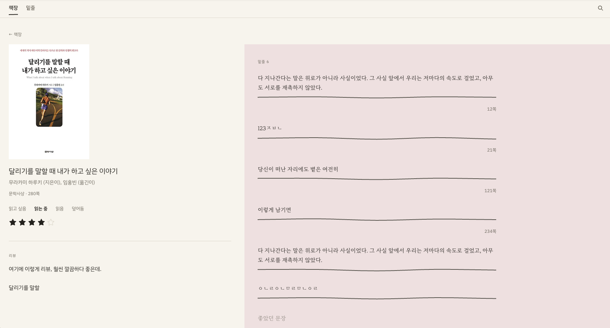
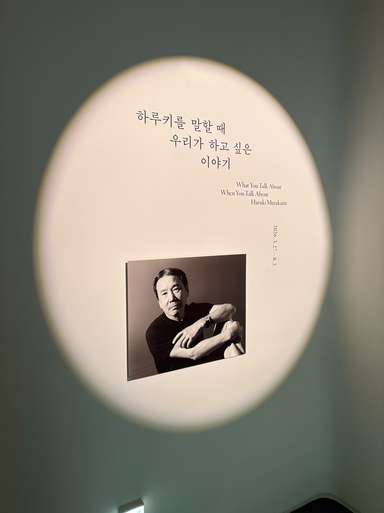
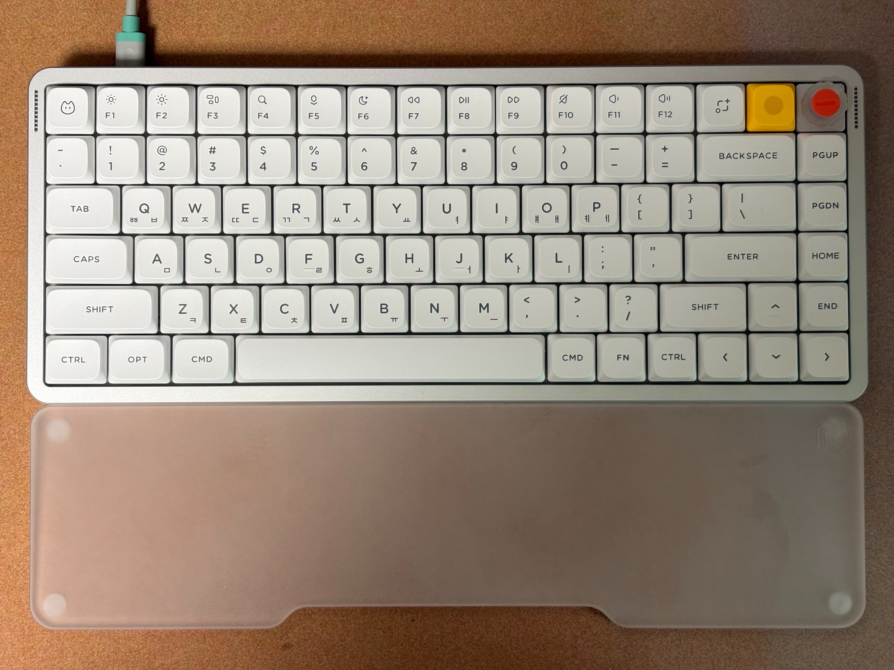

## 회고글 참여 활성화 프로젝트

회고 모임을 운영한 지 어느덧 3년이 넘었다. 시간이 흐르면서 참여율이 점점 떨어지기 시작했다. 어떤 달은 글을 쓴 사람이 절반도 안 됐다. 다들 각자의 일정이 있고 모임 날짜도 매번 투표로 정하니, 누군가의 불참은 자연스러운 일이다.

문제는 다른 데 있었다. 모임에 참석하지 못하면 글 자체를 안 쓴다는 점이었다. 심지어 나조차 그랬다. 참여 못 하는 달엔 슬그머니 건너뛰게 됐다. 참석 인원 변동은 어쩔 수 없다 쳐도, 글마저 안 쌓이니 함께 하고 있다는 느낌이 옅어졌다.

문제를 해결하기 위해 멤버들의 의견을 모아보기로 했다. 투표 결과는 흥미로웠다.

- 참여 못해도 글은 쓰자 -- 3표
- 가능하면 쓰되 강제는 말자 -- 3표
- 참여 못하면 패스해도 된다 -- 0표

놀랍게도 아무도 "안 써도 된다"를 고르지 않았다. 다들 쓰는 게 좋다고는 생각하지만 왜 행동으로 이어지지 않았을까?

내 경험을 되짚어보면, 솔직히 회고를 작성하는 과정 자체는 꽤 귀찮다. 하지만 막상 회고를 준비하고 사람들과 이야기를 나누고 나면 '역시 하길 잘했다'는 생각이 든다. 문제는 모임에 참여하지 않을 때 발생한다. 발표할 기회가 없으니 내 글이 읽히지 않고 그대로 휘발되는 느낌이 들고, 결국 써야 할 동기도 함께 옅어지는 것이다.

모임에 참석했을 때 얻는 경험을 분석해 보았다. 모임 날 온라인으로 10~15분간 발표를 하면, 사람들이 경청하고 반응하며 대화가 오간다. 이 실시간 반응과 상호작용이 글을 쓴 것에 대한 확실한 보상이었다는 생각이든다.

반면 모임에 못 나가면 이 보상이 통째로 사라진다. 글은 올릴 수 있지만 발표할 자리도 없고, 아무도 언급해주지 않는다. '어차피 못 나가서 발표도 못 하는데, 글은 왜 써?' 라는 심리가 지극히 자연스럽게 생겨나는 구조였다.

이 관점에서 풀어야 할 핵심 과제를 네 가지로 정리했다.

- 보상: 글을 쓰면 어떤 형태로든 피드백이 돌아오게 할 것
- 마찰: 부담 없이 짧게 작성할 수 있는 환경을 만들 것
- 신호: 지속적으로 글을 쓰도록 만드는 행동을 유도할 것
- 소속: 모임에 못 나와도 함께 가고 있다는 느낌을 줄 것

이 방향이 맞는지는 아직 모르겠다. 일단 해보는 수밖에. 그리고 이걸 두 갈래로 풀기로 했다. 기능과 온도.

### 온도: 갈피

원래 행동 유도를 위해 매달 리마인더 메일을 보내고 있었는데, 톤을 바꾸고 싶어졌다. "지난 액션 아이템 지켰나요?" 같은 문장은 뭔가 검사하는 느낌이 든다. 우리 모임은 좀 더 가벼운 회고인데.

톤을 바꾸려다가 더 근본적인 생각이 들었다. 이 메일을 내가 아닌 다른 누군가가 보내면 어떨까. 결국 발송하는 건 나지만, 내가 "글 좀 쓰세요" 하면 압박이 될 수도 있지만 다른 어떤 존재가 매달 안부를 묻는 메일이라면 괜찮지 않을까?

돌아올 자리를 표시해두는 책갈피. 그리고 갈피를 잡다, 방향을 찾다. 우리의 회고가 그 두가지를 하는 일이라서 이름이 마음에 들었다.

### 기능

좋아요와 댓글 같은 기능은 다음 달부터 시작해볼 계획이다.

마찰을 줄이는 쪽으로는, 이번 달부터 공통 질문을 하나씩 던져보기로 했다. 쓸 말이 없어도 한 줄은 쓸 수 있도록.

## 이달의 공통 질문 — 요즘 제일 자주 여는 앱(또는 사이트)은?

모서리라는 앱이다. 사실 내가 만든 독서앱이다. 내가 만든 앱을 내가 제일 많이 연다. 만들면서 열고, 쓰면서 열고, 고칠 게 보여서 또 열고.

이 앱의 자세한 설명은 다음으로

## 이달의 DIY 앱

이번 달은 독서앱을 하나 만들었다. 세상에 독서앱은 정말 많다. 아마 Todo 앱만큼이나 많이 만들어지지 않았을까. 그럼에도 굳이 만든 이유는 내가 만든 독서앱이 아직 없기 때문이다. 여러 앱을 찾아봤지만 내가 딱 원하는 정도의 기능과 디자인을 가진 앱은 찾기 어려웠다.

나는 책을 읽고 간단한 리뷰와, 그 책에서 마음에 들었던 문장을 페이지 수와 함께 옮겨 적는 것을 좋아한다. 공책부터 노션까지 많은 툴을 거쳐왔다. 노션은 오래 썼지만 전용 독서앱이 아니다 보니 내가 원하는 배치대로 뭔가를 할 수가 없었다. 필요한 기능이나 아이디어가 떠올라도 노션 안에서는 애초에 구현이 불가능한 것들이 있었다.

지난번 CHECKIN은 생각나는 대로 그때그때 작업해서 아쉬움이 있었다. 그래서 이번엔 기획의 빈틈을 최대한 오래 메우고 나서 시작했다.

만들고 나서 직접 써보니 좋았다. 노션에서의 불편함들이 해소됐다. 내가 유저이자 개발자라 쓰면서 실시간으로 불편을 접수하고 바로바로 업데이트한다. 불편이 그 자리에서 해결되는 셈이다.

아직 고쳐야 할 것들이 많지만 매우 만족스럽다. 혹시 문장 수집을 좋아한다면 한 번 들러 주시라. 아직 좀 느립니다.

https://moseori-gules.vercel.app/shelf

## 일상

### 하루키를 말할 때 우리가 하고 싶은 이야기

하루키의 문학과 라이프스타일, 그리고 그의 오랜 파트너였던 안자이 미즈마루의 그림에 대한 전시

하루키의 취향이 가득 담긴 전시였다. 러닝, 재즈, 위스키와 맥주, 고양이. 그리고 안자이 미즈마루의 삽화들. 나도 그것들을 좋아한다. 이제는 하루키를 좋아해서 이것들을 좋아하게 된 건지, 이것들을 좋아해서 하루키를 더 좋아하게 된 건지 모르겠다.

전시를 보며 나와 하루키의 공통점, 연결 고리 같은 걸 찾아보는 재미가 있었다.

### 키보드

처음으로 이런 '멋진' 키보드를 사봤다. NUPHY AIR75 V3. 너무 좋다.

이전 회사에서 키보드 좋아하는 사람들이 많아서 키보드 이야기를 정말 많이 듣고 또 보기도 했다. 그때는 크게 관심이 없었다. 그냥 이런 느낌이구나, 오 이쁘다. 이 정도의 감상이 전부였다. 나에게는 매직 키보드로도 충분했다.

시간이 흘러 매직 키보드는 더 이상 마법을 부릴 수 없게 되었다. 아니, 오히려 이상한 마법에 걸려 버렸다. '키보드'라는 단어를 입력하면 키ㅣㅣㅣㅣㅣㅣㅣ보드— 라고 입력된다.

빨리 필요해서 별다른 후보 고민 없이 바로 샀다. 예전에 어딘가 리뷰에서 봤던 기억이 떠올랐고, 그걸로 충분했다.

최근 회고 참여율을 높이려면 어떻게 해야 할까에 대해 그렇게 고민했는데, 답은 의외로 간단할지도 모르겠다. 새로운 장비를 사는 것을 추천 드립니다. 빨리 회고 글을 작성하면서 키보드를 마구 두드리고 싶어진다.
