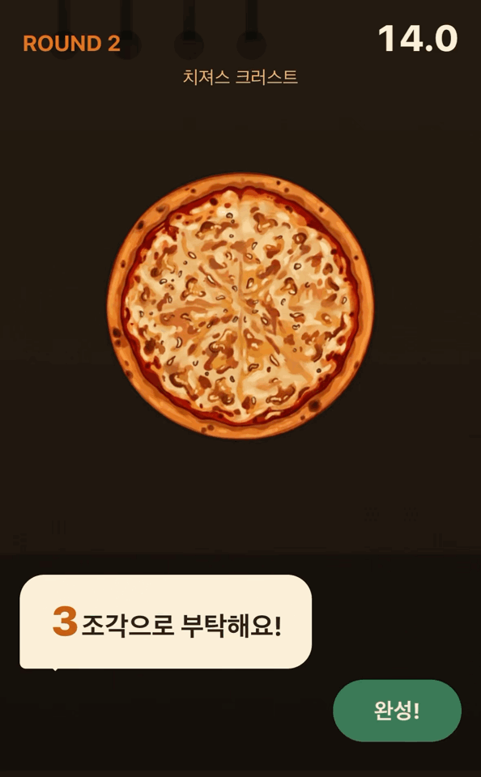
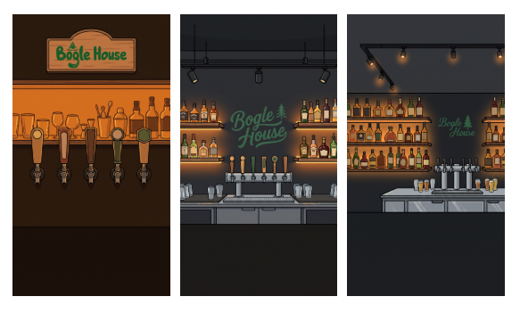
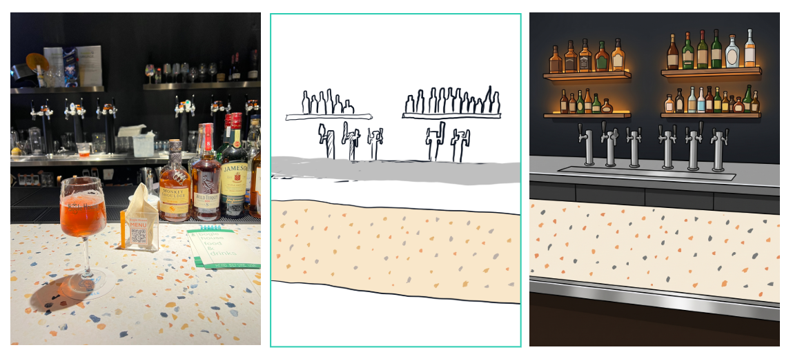
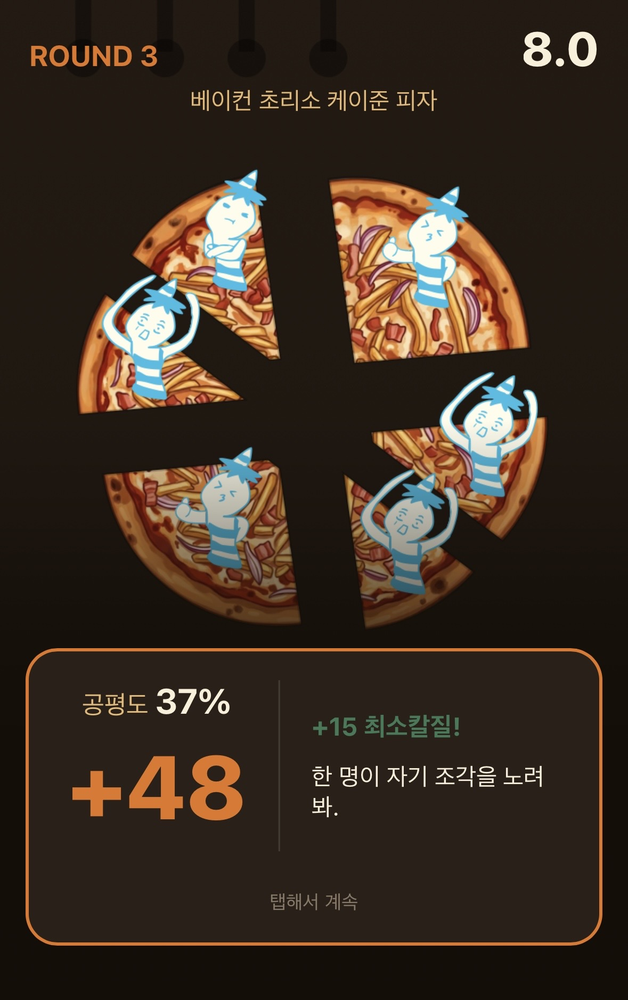
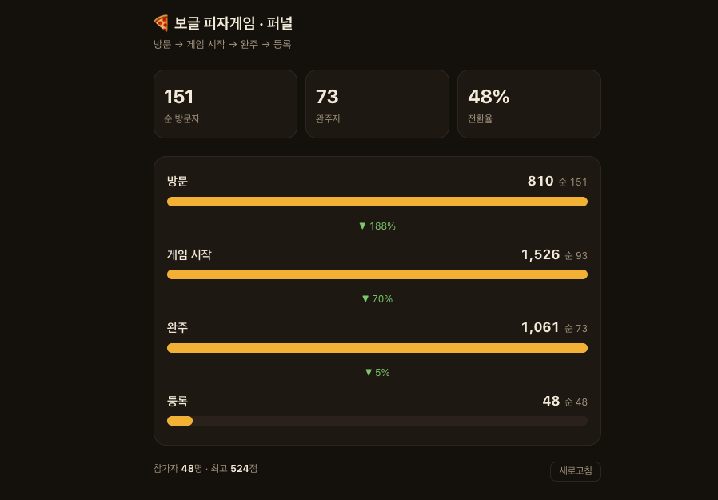
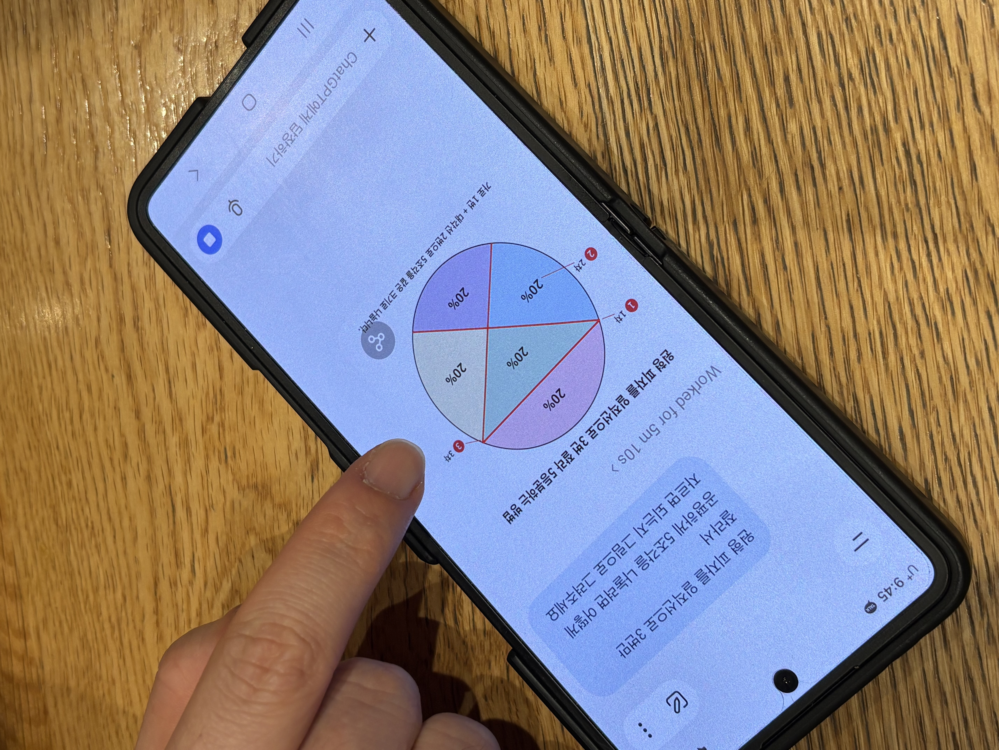

**[보글하우스라는](https://naver.me/IItcrFdZ)** 단골 펍이 있다. 크래프트 비어와 하이볼, 피자를 파는 곳이고, 나는 이곳을 꽤 오래 다녔다. 올해 4주년 파티를 한다는 이야기를 들었을 때, 뭔가 축하를 해주고 싶었다. 개발자스러운 축하를 고민하다 게임을 떠올렸다. 파티에 온 사람들이 폰으로 바로 열어서 가볍게 즐길 수 있는 작은 게임.

그래서 만들었다. 주방 알바가 되어, 손님이 주문한 개수만큼 피자를 최대한 공평하게 잘라내는 게임이다. 5라운드에 한 판이 90초쯤 걸리고, 마지막에 점수가 나오면 닉네임을 넣어 랭킹에 등록할 수 있다. 로그인은 없다. 링크를 열면 바로 시작한다.

이 글은 4주년 기념 피자 게임을 만들면서 했던 것들의 기록이다.

🎮 [플레이하기](https://bogle-4th-pizza-game.pages.dev/) · 💻 [GitHub](https://github.com/Jiwook00/bogle-4th-pizza-game)

## 보글하우스처럼 보이게 만들기

처음 프로토타입을 만들었을 때, 이건 그냥 피자 자르기 게임이지 전혀 보글하우스 4주년 선물이 아니었다. 이 프로젝트에서 가장 오래 공들인 건 로직이 아니라 이 부분이었다. 보글하우스스럽게 보이는 것.

그래서 게임의 콘텐츠를 전부 실제 매장에서 가져왔다. 라운드마다 나오는 피자는 실제 메뉴판 그대로다. 마지막 라운드는 피자가 아니라 4주년 기념 케이크를 자른다. 인트로에는 사장님 두 분이 바 카운터에 서서 대사를 치는 컷신을 넣었다. 매장을 아는 사람이라면 첫 화면에서 "어, 여기 거기잖아"가 나오도록 하고 싶었다.

문제는 그림이었다. 사장님과 매장, 그리고 보글하우스 마스코트를 게임 캐릭터로 만들어야 하는데, 나는 그림에 소질이 없다. 당연히 AI에게 시켰다. [Recraft](https://recraft.ai/)에 프롬프트를 넣고, 고치고, 다시 넣고, 거의 한 달치 토큰을 태웠다.

그럼에도 원하는 결과를 얻기 어려웠다. 한 장 한 장은 그럴듯한데 캐릭터의 일관성이 잡히지 않았다. 같은 사장님인데 컷마다 다른 사람이었다. 내가 원하는 디테일 — 캐릭터의 표정, 매장의 테이블 디자인, 조명 같은 것 — 은 텍스트로 아무리 설명해도 전달되지 않았다.

결국 아이패드를 꺼내서 직접 그렸다. 매장 사진들을 찾아서 보고 따라 그렸다. 잘 그린 그림은 아니지만 손그림을 레퍼런스로 주니까 의도가 잘 전달됐다. 텍스트로 열 번 설명하던 것 보다 그림 한 장이 나았다.

특히 매장의 디테일이 달라졌다. 실제 보글하우스를 보고 그린 것이다 보니, 바의 분위기와 테이블 디자인은 물론이고 맥주 탭이 놓인 위치까지 내가 원하는 대로 나왔다.

이런 작업을 할때는 내가 어느정도 가이드를 그려서 전달을 하는 게 좋을 거 같다.

## 공평하게 나누기

게임의 규칙은 하나다. 손님이 4명이면 4조각으로, 최대한 똑같은 크기로 잘라준다. 자를 때마다 조각 넓이를 계산해서, 가장 작은 조각을 가장 큰 조각으로 나눈 값이 공평도가 된다. 고르게 자를수록 100%에 가까워진다.

이 계산은 값을 구하는 순간 가장 손해 본 손님이 누구인지 자동으로 특정된다. 그 손님의 조각 위에 충격받은 표정이 뜨고, 라운드가 끝나면 한마디 한다. 이 연출 때문에 이러한 채점 방식을 골랐다.

자르는 방식은 두 가지를 만들어봤다. 손가락 궤적을 그대로 따라가는 자유 곡선, 그리고 궤적을 받되 직선 하나로 수렴시키는 방식. 곡선은 자유도가 높은데, 만들어놓고 보니 피자 칼로 한 번에 쭉 미는 느낌이 없고 선이 복잡하고 지저분해졌다. 그래서 지금 게임은 손가락은 자유롭게 긋게 두되, 그 궤적에 직선을 피팅해서 자른다.

## 숫자로 본 결과

배포 후에 이게 실제로 얼마나 쓰였는지 보고 싶어서, 파티 전에 방문 → 게임 시작 → 완주 → 랭킹 등록 네 단계의 퍼널 이벤트를 심고 간단한 상태 페이지를 만들었다.

방문자의 48%가 게임을 끝까지 마쳤고, 32%가 랭킹에 이름을 남겼다. 다만 이 숫자를 일반적인 웹 트래픽과 비교하기는 어렵지 않을까. 이미 행사에 참여하는 사람 대상이고, 아는 사람이 만들었다고 소개받고, 옆에서 하는 걸 본 사람들이다. 그럼에도 절반이 끝까지 갔다는 게 좋았다.

개인적으로 더 마음에 든 건 다른 숫자다. 게임 시작 이벤트가 1,526회였다. 93명이 눌렀다. 1인당 16판이다. 짧게 만들고 재도전을 쉽게 해서 랭킹에 도전하도록 한 의도가 어느정도 통한 거 같다.

## 현장에서 본 것

현장에서 게임에 대해 이야기하는 사람들, 재밌게 했다는 후기, 사장님들의 반응, 랭킹을 위해 치열하게 고민하던 사람들을 직접 보면서 너무 즐거웠다.

내가 만든 게임을 나보다 더 즐기고, 내가 생각하지 못한 방식으로 공략하는 모습도 재밌었다. 이런 각도로도 자를 수 있구나 싶은 순간이 여러 번 있었다.

이전 회사에서 학교 실습 현장에 나갔을 때, 학생들이 우리가 만든 걸 쓰는 모습을 보며 느꼈던 감정을 오랜만에 다시 느껴서 좋았다. 서비스는 만드는 것으로 끝나지 않고, 누군가 쓰는 걸 볼 때 비로소 완성되는 것이 아닐까.

4주년 축하해요, 보글하우스.

🎮 [플레이하기](https://bogle-4th-pizza-game.pages.dev/) · 💻 [GitHub](https://github.com/Jiwook00/bogle-4th-pizza-game)
