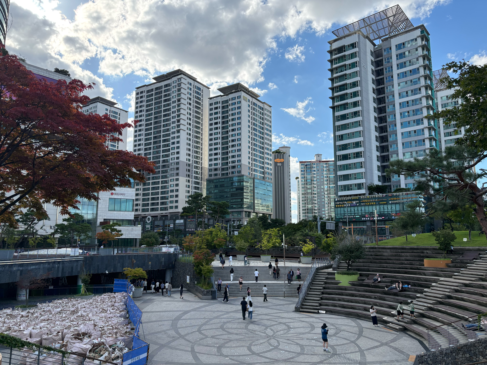
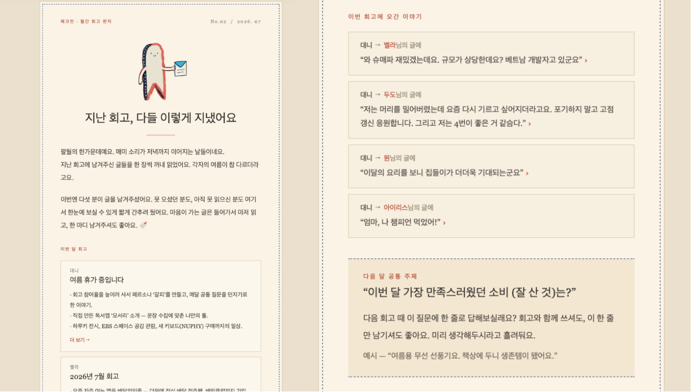
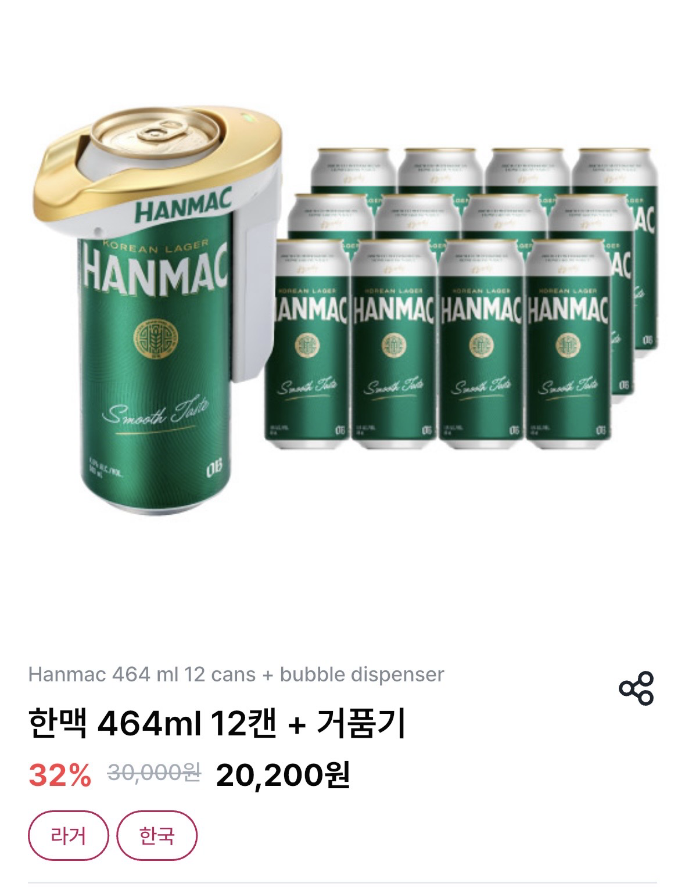
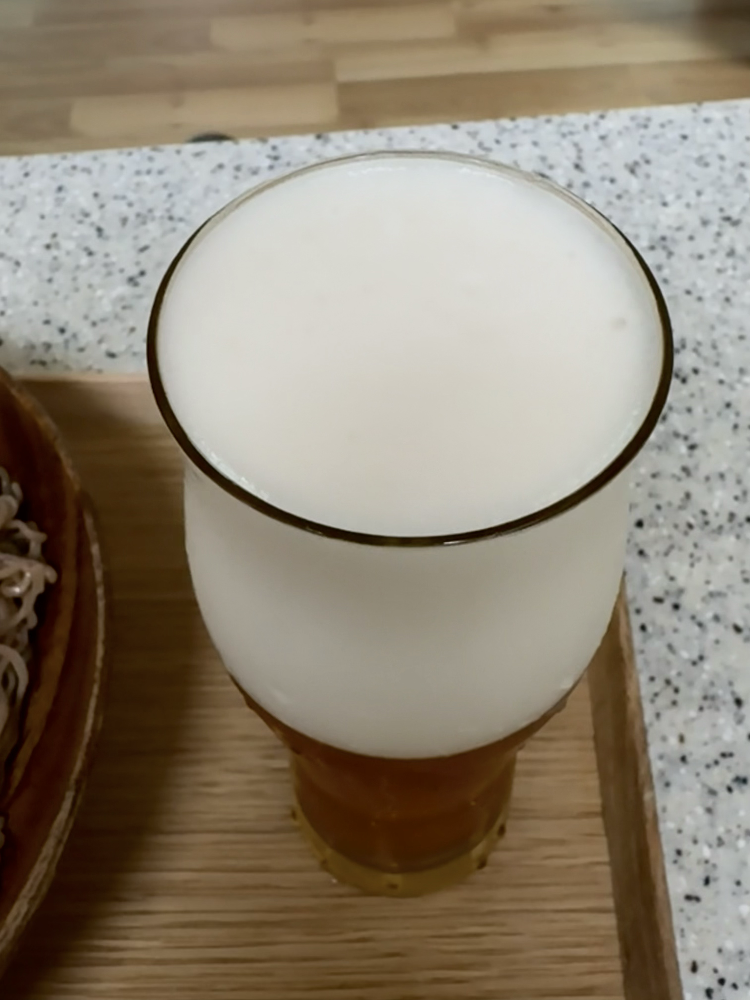

그을린 여름이 아직 가시지 않은 것 같은데 벌써 9월이 왔다. (윤종신 - 9月)

사진은 약속이 있어 문래동에 갔던 날이었다. 아직 햇빛은 뜨겁지만 시원해진 공기에 다들 기분 좋게 그늘에 앉아 쉬고 있는 모습이 여유롭고 좋아 보였다. 나도 나무 그늘 아래서 잠시 가을을 느끼며 노래를 들었다.

내 뒤에 앉은 누군가가 이날의 디제이였다. 고르는 노래들이 꽤나 취향 저격이었다. 이어폰을 빼면 눈치챌까 봐, 슬그머니 노이즈 캔슬링만 끄고 그들의 플레이리스트에 몰래 동참했다.

우연히 마주한 타인의 음악과 선선한 가을바람 덕분에, 머릿속을 비우고 기분 좋은 여유를 누릴 수 있었다. 이 기분 좋은 여유를 빌려 지난 8월의 기록을 차분히 돌아보자.

## 회고 글 참여 활성화 프로젝트는

지난달 계획했던 **댓글과 이모지를 남기는 기능을 추가했다.** 그 후 아직 회고를 진행하지 않아서 제대로 사용해 보지는 못했다. 아직 멤버들에게 홍보가 덜 된 것일까? 이번 회고를 기대해본다. 🙏

회고 글 참여 활성화 프로젝트의 일환으로, ​**멤버 전체에게 공통 질문을 던지는 것**​도 시도하고 있다. 지난달 주제는 "요즘 제일 자주 여는 앱(또는 사이트)은?"이었는데, 절반 정도가 참여해줬다. 그중 제일 좋았던 건, 최근 뜸했던 멤버가 이 공통 질문 덕분에(진짜 그렇다면 좋겠지만) 오랜만에 회고 글을 남겼다는 것. 이 방식이 진짜 효과가 있는 건지는 아직 잘 모르겠다. 몇 달은 더 해봐야 알 것 같다. 지금은 가볍게 답할 수 있는 주제 위주로 하고 있고, 나중엔 좀 더 다양하고 깊이 있는 질문들도 해볼 생각이다.

​**메일을 보내는 갈피**​는 아직 갈피를 잡지 못하고 있다. 여러 형식으로 보내보고 있다. 공통 메일, 개별 맞춤 리마인더나 달린 댓글을 알려주기도 해보고 있다. 매번 조금씩 달라지고 있는데, 그중에서 가장 괜찮은 조합을 찾아볼 생각이다.

## 피자 게임

단골 펍인 **보글하우스 4주년 파티 선물로 웹게임을 만들었다.** 주방 알바가 되어 손님이 주문한 개수만큼 피자를 최대한 공평하게 잘라내는 게임이다.

콘텐츠는 전부 실제 매장에서 가져왔다. 메뉴판 그대로의 피자, 마지막 라운드엔 4주년 케이크, 인트로엔 사장님 두 분이 등장하는 컷신까지. 사실 이 프로젝트에서 로직보다 훨씬 오래 공들인 건 '보글하우스처럼 보이게 만드는 것'이었다. 이미지 생성 AI로 거의 한 달치 토큰을 태웠는데도 일관성이 안 잡혀서, 결국 아이패드를 꺼내 직접 그렸다. 텍스트로 열 번 설명하는 것보다 그림 한 장이 나았다.

현장에서 사람들이 재밌게 하는 모습, 랭킹 때문에 치열해지는 모습을 보는 게 좋았다. 만든 것으로 끝나지 않고 누군가 쓰는 걸 볼 때 비로소 완성된다는 걸 오랜만에 다시 느꼈다.

자세한 개발 후기는 블로그에 따로 적었다. [단골 펍 4주년에 피자 게임을 선물했다](https://dwook.co/blog/04-bogle-4th-pizza-game)

## 블로그

그동안 매번 “해야지, 해야지” 마음만 먹던 **블로그와 포트폴리오 구축을 드디어 시작했다.** 마음에 드는 블로그 레퍼런스를 찾다가 [Astro](https://astro.build/) 프레임워크로 미니멀한 템플릿, [‘Astro Nano’](https://astro-nano-demo.vercel.app/)라는 프로젝트를 발견했다. 메인 화면에 내 소개, 프로젝트, 경력(Work), 그리고 블로그 글 미리보기가 깔끔하게 모여 있고, 각 탭을 통해 상세 내용을 볼 수 있는 구조였다. 딱 내가 찾던 '포트폴리오 겸 블로그'로 쓰기 완벽한 포맷이다.

잘 짜인 프레임워크와 템플릿 덕분에 초기 세팅은 금방 끝낼 수 있었다. 특히나 이런 경우 커스텀이나 배포 과정은 AI 덕을 많이 보는 거 같다. 하지만 역시 진짜 어려운 건 지금부터다. 블로그를 '만드는 것'보다 그 안의 '내용을 채우는 것'이 훨씬 더 중요하고 본질적인 일이니까. 겉모습은 마음에 드는데, 이제 이 공간을 의미 있게 채워가야 한다.

## 회고 공통 질문 — 이번 달 가장 만족스러웠던 소비 (잘 산 것)는?

**한맥 크리미 거품기다.** 유튜브 채널 [요리독학GYU의 맥주 따르는 영상에서 2도 따르기라는 방식을 소개했는데](https://youtu.be/REqKQXOyYhE?si=YV1WlQOB_DrpjsO1&t=513), 그것을 보고 바로 구매를 했다.

이러한 초음파 맥주 거품기는 이미 10년 전에도 사용한 적이 있었는데 생각만큼 차이를 못 느껴서 한두 번 쓰고 버려졌다. 하지만 그건 ‘제대로 된 사용 방법’을 몰라서 그런 거였다.

영상을 보고 알게 된 핵심 요령은 맥주를 일반 방식으로 따른 후에 생긴 거친 거품 위에 초음파 진동을 통해 생성된 크리미한 거품으로 기존의 거품을 밀어내는 것이다. 두 번 따르기 때문에 2도 따르기라고 한다.

이렇게 완성한 2도 따르기 맥주는 입술에 닿는 감촉이 말도 못 하게 부드럽다. 캔맥주 한 잔에서 마치 일본의 유명 맥주 바나 전문 펍에서 갓 짜낸 생맥주를 마시는 듯한 황홀한 기분을 선사한다.

다만, 유일한 단점이라면 이 거품기를 얻기 위해 한맥 12캔을 인질로 잡혔다.

