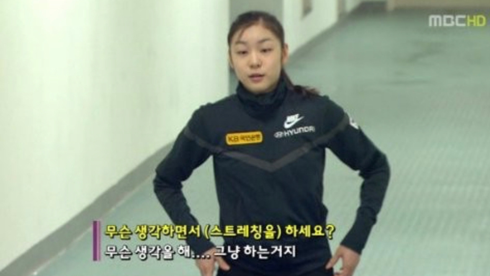

이번 달부터 본격적으로 이직 준비를 시작했다. 한 회사에 오래 있다가 오랜만에 이력서를 쓰려니 참 막막했다. 준비하면서 가장 많이 한 생각은 '미리 좀 해둘걸'이다. 껄무새가 되어가고 있다.

진행했던 프로젝트들을 문제 상황, 해결 과정, 결과로 정리하고 있다. 당시에는 많은 고민을 했었다. 왜 그렇게 판단했는지, 무엇을 왜 포기했는지. 문서로 남겨둔 것도 있지만 정리되지 않은 문서는 어디론가 사라졌고, 그때의 기억은 희미해졌다. 매달 회고는 쓰면서, 일에 대한 회고는 쓰지 않았음을 반성하는 회고다.

## 뒤늦은 복기

그래도 좋은 점이 하나 있다. 이력서와 경력기술서를 쓰고, 그걸 바탕으로 면접 준비를 하다 보니 공부가 많이 된다.

면접 꼬리 질문처럼 '그때는 왜 그랬지?'를 스스로 묻다 보면, 그때는 맞다고 믿었던 것들이 흔들린다. 면접 준비를 하며 뒤늦은 복기를 하고 있다.

### 잘못된 풀이

이력서에 아두이노 컴파일 서버를 Node.js에서 Go로 옮긴 프로젝트가 있다. 블록 코딩의 컴파일 서버였는데, 요청이 조금만 몰려도 서버가 버거워했다. 당시 내 진단은 'Node.js가 단일 스레드라서'였다. 그래서 고루틴 기반으로 다시 설계하고, 세마포어로 동시에 처리할 수 있는 상한을 걸었다.

그런데 꼬리 질문을 따라가 보니 진단이 틀렸다는 걸 알게 되었다. 컴파일 서버는 arduino-cli를 차일드 프로세스로 띄워서 처리한다. 무거운 일은 별도 프로세스에서 돌아가니, 단일 스레드가 병목일 이유는 없었다. 진짜 문제는 상한이 없었다는 것이다. 요청이 들어오는 대로 다 받아서 프로세스를 띄웠고, CPU를 많이 쓰는 컴파일 작업이 한꺼번에 몰리면서 CPU와 메모리가 바닥났다. 사실 Node.js에서 동시에 실행되는 개수만 제한했어도 됐을 일이다. 가장 적은 비용으로.

그렇다고 Go로 옮긴 게 잘못이었다고 생각하지는 않는다. AI 덕분에 언어를 바꾸는 부담이 많이 줄었고, 이미 돌아가는 서비스라 결과가 맞는지 검증하기도 쉬웠다. 서버 자체도 가벼워졌고 동시성을 다루기도 편해졌다. 풀이는 틀렸는데, 답은 맞힌 게 아닐까.

### 창작자의 지능

AI를 적극적으로 쓴 최근 프로젝트들도 다시 들여다봤다. 깊게 파고들수록 그땐 몰랐던 것들이 보였고, 충분히 다른 방향으로 풀 수도 있었겠다 싶었다. 컴파일 서버도 그랬다. 원인이 단일 스레드라고 믿고 있었으니, AI에게도 그 안에서만 물었을 것이다.

드라마나 영화 속 캐릭터의 지능은 창작자의 지능을 넘을 수 없다는 말이 있다. AI로 개발할 때도 똑같은 것 같다. AI의 답은 결국 내 질문의 크기를 넘지 못한다. AI 시대에도 여전히 기본기가 중요하다고 느꼈다.

늦었지만 앞으로는 이력서를 주기적으로 업데이트해야겠다고 다짐했다. 미리 좀 해둘걸.

## 회고 공통 질문 — 긴 휴식 후 다시 원래의 리듬을 되찾는 나만의 방법은?

이번 [회고](/projects/checkin) 모임의 공통 질문은 "긴 휴식 후 다시 원래의 리듬을 되찾는 나만의 방법은?"이다. 마침 추석 연휴가 끝나고 회고를 쓰려던 참에 이 질문을 받았다. 타이밍이 절묘했다.

지금은 직장인이 아닌데도 불구하고 추석 연휴 같은 이벤트가 생기면 괜히 마음이 풀어지고 느긋해지는 것 같다. 이미 쉬고 있지만 조금 더 쉬어줬다. 쉬는 사람에게도 연휴는 연휴다. 문제는 그다음이다. 일상의 루틴으로 돌아가기가 쉽지 않다.

나만의 방법이라면 청소다. 연휴의 흐트러짐이 평일까지 넘어오면 그때부턴 더욱 힘들어진다. 그래서 마지막 날은 비우기를 하며 복귀 준비를 한다. 청소기를 돌리고, 빨래를 하고, 커피 머신을 세척하고, 사진첩을 비운다. 청소는 집도 환기시키지만 머리도 환기시킨다.

하나같이 너무너무 귀찮은 일들이다. 그래도 몸을 움직이는 일이라, 일단 시작하면 관성이 붙어서 쭉 하게 된다. 다 끝나고 나면 뭔가 맑아진 기분이 든다.

깨끗해진 머신으로 커피를 내리고, 일단 책상에 앉는다. 지구를 위해 쌓인 메일함을 정리하고, 밀린 뉴스레터를 읽는다. 생산적인 척하는 그런 것들을 하다 보면 정말 생산적인 일을 하고 있는 것 같은 기분이 든다.

그렇게 마지막 날을 정리의 날로 보내면, 다음 날은 역시 힘들다.

사실 잘 모르겠다. 리듬을 되찾는 방법 같은 건 애초에 없는 걸지도 모른다. 그냥 하는 수밖에.

