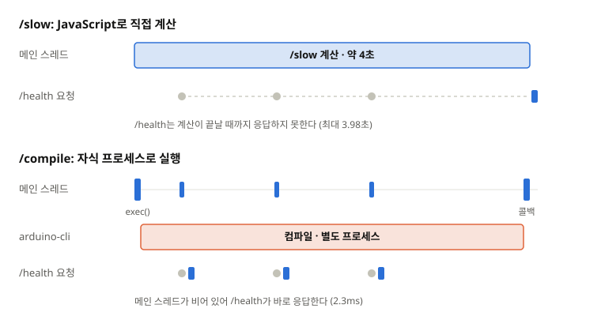
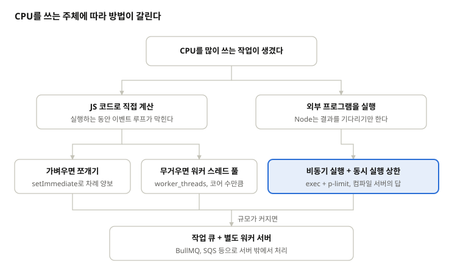

## 들어가며

블록 코딩 교육 플랫폼을 운영하던 회사에서, 학생이 블록으로 만든 코드를 아두이노 보드에 올리는 기능이 있었다. 브라우저에서는 아두이노 코드를 컴파일할 수 없으니, 서버가 코드를 받아 arduino-cli로 컴파일하고 결과를 돌려주는 API가 필요했다. 이 컴파일 서버는 Node.js로 만들어져 있었다.

평소에는 문제가 없었다. 문제는 수업 시간에 발생했다. 업로드할 차례가 되면 동시 컴파일 요청이 많아졌다. 그러면 평균 응답 시간이 120초까지 늘어났고, 우리는 수업 시간대마다 서버를 늘려서 버티고 있었다.

처음에 나는 원인이 Node.js는 싱글 스레드라서 컴파일 같은 CPU 집약적 작업에 약하다고 생각했다. 흔히 듣던 말이었다. 그런데 Node.js 공식 문서를 읽고 다시 확인해보니, 이 설명은 우리 상황에는 들어맞지 않았다. 이 글은 그 과정을 정리한 것이다.

## 컴파일 서버의 구조

흐름을 단순하게 정리하면 이렇다. (일부 과정은 생략했다)

1. 클라이언트가 블록에서 생성된 아두이노 코드(스케치)를 보낸다.
2. 서버가 스케치를 임시 디렉터리에 파일로 저장한다.
3. `exec`로 `arduino-cli compile` 명령을 실행한다.
4. 컴파일이 끝나면 결과 바이너리를 읽어 응답한다.

코드로 옮기면 대략 이런 모양이다. 실제 코드를 단순화한 예시다.

```js
app.post("/compile", (req, res) => {
  const dir = saveSketch(req.body.code); // 임시 디렉터리에 저장
  exec(
    `arduino-cli compile --fqbn ${FQBN} --output-dir ${dir}/build ${dir}`,
    (err, stdout, stderr) => {
      if (err) return res.status(400).json({ error: stderr });
      res.json({ hex: readHex(dir) });
    },
  );
});
```

동시에 몇 개를 컴파일할지에 대한 제한은 없었다. 요청이 30개 오면 arduino-cli 프로세스도 30개가 뜬다. 서버는 t3.small(vCPU 2개, 메모리 2GB)이었다.

## "Node.js는 CPU 작업에 약하다"는 말의 정확한 의미

Node.js는 JavaScript 코드를 메인 스레드 하나(이벤트 루프)에서 실행한다. DB 조회나 외부 API 호출처럼 기다리는 작업은 OS에 맡겨두고 그동안 다른 요청을 처리하니 문제가 없다. 하지만 JavaScript로 무거운 계산을 직접 하면, 그 계산이 끝날 때까지 이벤트 루프가 붙잡혀 다른 모든 요청이 멈춘다.

```js
app.get("/slow", (req, res) => {
  let sum = 0;
  for (let i = 0; i < 5e9; i++) sum += i; // 수 초 동안 이벤트 루프를 붙잡는다
  res.json({ sum });
});
```

위 코드 `/slow`가 실행되는 동안에는 다른 엔드포인트도, 헬스체크도 응답하지 못한다. "Node.js는 CPU 작업에 약하다"는 말은 정확히는 "JavaScript로 직접 하는 CPU 작업이 이벤트 루프를 막는다"는 뜻이다.

Node.js 공식 문서의 [Don't Block the Event Loop (or the Worker Pool)](https://nodejs.org/learn/asynchronous-work/dont-block-the-event-loop)([한국어 번역](https://tastekim.gitbook.io/nodejs-ko/learn/asynchronous-work/dont-block-the-event-loop))는 이 문제를 자세히 다룬다. 핵심만 추리면 이렇다.

- Node.js에는 두 종류의 스레드가 있다. JavaScript 콜백을 실행하는 이벤트 루프 하나, 그리고 파일 I/O나 암호화 같은 비싼 작업을 맡는 워커 풀(기본 4개)이다.
- Node.js가 적은 스레드로 많은 요청을 처리할 수 있는 건, 요청마다 하는 일이 한 번에 "작을" 때뿐이다.
- 요청마다 스레드를 주는 서버와 달리, 오래 걸리는 작업을 OS가 대신 끊어주지 않는다. 요청을 공평하게 처리하는 건 개발자의 책임이다.
- 이벤트 루프를 막는 대표적인 범인은 입력 크기에 따라 폭발하는 반복문, 위험한 정규식(ReDoS), `execSync` 같은 동기 API, 거대한 JSON 처리다.
- 무거운 계산이 불가피하면 두 가지 방법이 있다. 계산을 잘게 쪼개 사이사이 차례를 양보하는 쪼개기(partitioning), 그리고 계산을 다른 스레드나 프로세스로 넘기는 떠넘기기(offloading)다.

그렇다면 컴파일 서버는 이벤트 루프를 막고 있었을까? 코드를 보면 그렇지는 않았다.

## 컴파일 코드는 이벤트 루프를 막지 않았다

컴파일을 실행한 `exec`는 비동기 함수다. `exec`를 호출하면 Node.js는 OS에 새 프로세스를 만들어 달라고 요청하고, 콜백만 등록한 뒤 바로 리턴한다. 이벤트 루프는 컴파일이 끝나길 기다리지 않고 다음 요청을 받으러 간다. 컴파일이 끝나 프로세스가 종료되면, 그때 등록해 둔 콜백이 실행될 뿐이다.

만약 `execSync`를 썼다면 이야기가 달랐을 것이다. 컴파일 하나가 끝날 때까지 이벤트 루프 전체가 멈추고, 공식 문서가 서버에서 쓰지 말라고 경고하는 바로 그 상황이 된다. 하지만 우리는 비동기 `exec`를 썼다.

오히려 우리 서버는 공식 문서가 권하는 떠넘기기 구조였다. 무거운 컴파일은 arduino-cli라는 별도 프로세스가 하고, Node.js는 요청을 받아 프로세스를 띄우고 결과를 돌려주는 지휘만 했다. 문서의 표현대로, 이벤트 루프는 요청을 직접 처리하는 게 아니라 지휘하는 역할을 하고 있었다.

하나 더 짚을 점은, 자식 프로세스가 끝나길 기다리는 데는 워커 풀도 쓰이지 않는다. libuv는 프로세스 종료를 OS의 신호(SIGCHLD)로 알아챈다. 그래서 Node.js 쪽에는 동시에 도는 자식 프로세스 수를 제한하는 장치가 전혀 없었고, 요청 30개가 그대로 프로세스 30개가 됐다.

로컬에서 그 차이를 재현해 보았다. t3.small처럼 vCPU 2개, 메모리 2GB로 제한한 Docker 컨테이너에서, 바로 응답만 하는 가벼운 엔드포인트 `/health`가 얼마나 늦어지는지 재 봤다. 앞에서 본 `/slow`(JavaScript로 직접 계산)가 도는 동안에는 `/health`가 3.9초 동안 막혔고, `/compile`(자식 프로세스로 실행)이 도는 동안에는 2.3ms만에 응답했다.



이벤트 루프가 정말 막혔는지는 측정으로 확인할 수 있다. Node.js에 내장된 `monitorEventLoopDelay`는 이벤트 루프가 제때 돌지 못하고 밀린 시간을 잰다.

```js
import { monitorEventLoopDelay } from "node:perf_hooks";

const h = monitorEventLoopDelay({ resolution: 20 });
h.enable();
setInterval(() => {
  const p99 = (h.percentile(99) / 1e6).toFixed(1);
  const max = (h.max / 1e6).toFixed(1);
  console.log(`event loop delay p99: ${p99}ms, max: ${max}ms`);
  h.reset();
}, 5000);
```

읽을 때 주의할 점이 있다. 측정값에는 resolution 자체가 포함돼서, 아무 일도 하지 않을 때도 값이 resolution(여기서는 20ms) 근처에서 시작한다. 그래서 절대값보다 평소보다 얼마나 튀는지를 봐야 하고, 짧은 블록은 p99에 묻히기 쉬우니 max도 함께 본다. 또 값이 튄다고 해서 곧 JavaScript가 막고 있다는 뜻은 아니다. 이 이야기는 뒤에서 다시 다룬다.

## 컴파일은 CPU 작업인가, I/O 작업인가

여기서 헷갈리는 지점이 생긴다. 컴파일은 분명 CPU를 많이 쓰는 작업이다. 그런데 Node.js 입장에서 보면, arduino-cli가 끝나길 기다리는 건 DB 응답을 기다리는 것과 다르지 않다. 요청을 던져두고 다른 일을 하다가, 끝났다는 알림이 오면 결과를 받기 때문이다.

결국 누구의 관점에서 보느냐에 따라 답이 달라진다.

- **Node.js 프로세스의 관점**: 직접 CPU를 쓰는 건 요청을 받고, 자식 프로세스를 띄우고, 응답을 보내는 짧은 순간뿐이다. 그 외의 시간은 외부 프로세스가 끝나길 기다리는 **I/O(프로세스 간 통신) 대기 시간**에 가깝다.
- **서버 머신의 관점**: arduino-cli가 코어를 꽉 채우며 전처리, 컴파일, 링크를 수행한다. 명백한 **CPU 바운드 작업**이다.

여기서 두 가지를 알 수 있다.

첫째, **Node.js가 싱글 스레드라는 건 어디까지나 'JavaScript 실행'에 국한된 이야기다.** Node.js가 띄운 자식 프로세스는 완전히 별개의 영역이므로, OS가 서버의 멀티 코어에 골고루 나눠서 실행한다.

둘째, 매 요청마다 CPU를 과도하게 차지하는 주체가 Node.js가 아니라면, 문제를 해결할 열쇠도 Node.js 런타임 내부가 아니라 '**이 외부 프로세스들을 어떻게 효율적으로 제어하고 스케줄링할 것인가**'에 있다.

## 진짜 원인: 떠넘기기의 경고

공식 문서는 떠넘기기를 권하면서 두 가지를 경고한다. 다시 읽어보니 우리 서버는 정확히 그 둘을 어기고 있었다.

첫째, 요청마다 자식 프로세스를 만들지 말 것. 요청이 프로세스를 만들고 정리하는 속도보다 빨리 들어오면 서버가 감당하지 못한다. 우리 서버는 요청이 올 때마다 상한 없이 arduino-cli를 띄웠다.

둘째, CPU 작업의 수가 코어 수를 넘으면 메모리와 스케줄링 비용만 늘어난다는 것. 문서는 남는 작업이 진행하지 못한다고 표현하지만, 실제로는 OS가 시간을 쪼개 모두를 조금씩 느리게 진행시킨다. 우리는 vCPU 2개짜리 서버에서 컴파일 30개를 동시에 돌렸다.

### 공평하게 나눠 주면 모두가 늦게 끝난다

코어보다 프로세스가 많으면 OS는 CPU 시간을 잘게 썰어 모두에게 공평하게 나눠 준다. 문제는 공평하다는 것 자체다.

예를 들어 컴파일 한 건에 코어 하나를 4초 동안 써야 한다고 해 보자. (이해를 돕기 위한 가정이다.) 30개가 코어 2개를 공평하게 나눠 쓰면 각자 15분의 1 속도로 진행하고, 모두가 약 60초에 함께 끝난다. 첫 번째로 요청한 학생도 마지막 학생과 거의 같이 결과를 받는다.

반대로 두 개씩만 돌리고 나머지는 줄을 세우면, 4초에 두 명, 8초에 두 명씩 차례로 끝난다. 마지막 학생은 여전히 60초 근처에 끝나지만, 평균 대기 시간은 약 32초로 거의 절반이 된다. 서버가 처리하는 총량은 같은데, 먼저 온 요청이 먼저 끝나는 순서가 생기는 것만으로 평균이 줄어든다.

은행 창구 2개에 손님 30명이 한꺼번에 왔다고 생각하면 쉽다. 직원이 30명의 업무를 1분씩 돌아가며 보면 모두가 끝까지 기다려야 하지만, 한 명씩 차례대로 끝내 주면 앞사람부터 먼저 일을 보고 돌아갈 수 있다.

실제 서버에서는 메모리 부족 같은 다른 요인도 섞여 있었을 수 있다.

결국 문제는 Node.js가 CPU를 못 쓴 게 아니었다. Node.js가 띄운 프로세스들이 코어 2개를 두고 너무 많이 경쟁하고 있었다.

## 해결: 동시 실행 상한과 대기열

원인을 알고 나니 해결책은 단순했다. 동시에 실행할 컴파일 수를 정해 두고, 나머지 요청은 순서대로 기다리게 하면 된다.

```js
import pLimit from "p-limit";
import { exec } from "node:child_process";
import { promisify } from "node:util";

const run = promisify(exec);
const limit = pLimit(2); // 동시 컴파일 수, 나머지는 선착순 대기

app.post("/compile", async (req, res) => {
  if (limit.pendingCount > 50) return res.status(503).end(); // 대기열 상한

  const dir = saveSketch(req.body.code);
  try {
    await limit(() =>
      run(
        `arduino-cli compile --fqbn ${FQBN} --output-dir ${dir}/build ${dir}`,
      ),
    );
    res.json({ hex: readHex(dir) });
  } catch (err) {
    res.status(400).json({ error: err.stderr ?? err.message }); // 컴파일 에러
  }
});
```

핵심은 `pLimit()` 한 줄이다. 나머지는 공식 문서의 원칙과, 실제 운영에서 부딪힐 문제에서 나왔다.

- 대기열 상한: 줄이 끝없이 길어지면 메모리가 쌓이고 사용자는 무한정 기다린다. 감당할 수 없으면 빨리 실패시키는 게 낫다.

### 상한값은 어떻게 정하나

공식 문서대로라면 코어 수가 기준이다. 컴파일에는 파일을 읽고 쓰는 대기 구간도 섞여 있어서 조금 더 크게 잡을 여지가 있다. 반대로 arduino-cli가 한 번의 컴파일 안에서 이미 여러 코어를 쓴다면 더 작게 잡아야 할 수도 있다. 그래서 코어 수인 2에서 시작했다.

다만 이 값은 추측에서 출발한 출발점일 뿐이다. 상한값을 환경 변수로 바꿀 수 있게 하고, 실행 중인 수(`limit.activeCount`)와 대기 중인 수(`limit.pendingCount`)를 지표로 내보내 부하를 보며 조정하는 게 더 중요하다.

### 측정 결과

t3.small을 흉내 내 vCPU 2개, 메모리 2GB로 제한한 Docker 컨테이너에서 로컬로 재현했다. arduino-cli 대신 반복 횟수가 고정된 CPU 작업을 자식 프로세스로 띄웠고, 요청 30개를 동시에 보냈다.

| 동시 요청 30개 | 첫 완료 | 평균   | 최대   | /health 최대 |
| -------------- | ------- | ------ | ------ | ------------ |
| 상한 없음      | 7.48초  | 8.28초 | 8.71초 | 152ms        |
| pLimit(2)      | 0.68초  | 4.77초 | 8.84초 | 121ms        |

앞의 계산과 그대로 맞는다. 마지막 요청이 끝나는 시간은 거의 같고, 평균은 약 42% 줄었다.

상한을 걸면 지휘자인 Node.js 자신도 보호할 수 있다. JavaScript가 아무것도 막지 않아도, 자식 프로세스가 너무 많이 뜨면 OS가 Node.js에게 나눠 주는 CPU도 줄어들고, 프로세스를 만드는 일 자체도 메인 스레드에서 일어난다. 코어 8개에 요청 120개를 보낸 실험에서는 상한이 없을 때 `/health` 응답이 961ms까지 늘었고, `pLimit`을 걸자 이벤트 루프 지연 최대값이 37ms로 내려갔다. 실제 서버였다면 헬스체크가 실패했을 수도 있는 수준이다.

## Node.js에서 CPU 작업을 다루는 방법

정리하면, Node.js에서 CPU 작업을 다루는 방법은 CPU를 누가 쓰느냐에서 갈린다.



JavaScript로 직접 계산하면 이벤트 루프를 지키는 게 과제이고, 외부 프로그램에 맡길 때는 몇 개를 동시에 돌릴지가 과제다.

- 쪼개기: 계산을 작은 조각으로 나누고, 조각 사이마다 `setImmediate`로 다른 요청에게 차례를 넘긴다. 구현은 간단하지만 이벤트 루프 하나에서 돌기 때문에 코어를 하나밖에 못 쓴다. 가벼운 반복 작업에 맞다.
- 워커 스레드 풀: `worker_threads`로 별도 스레드에서 JavaScript를 실행해 다른 코어를 쓴다. 요청마다 워커를 새로 만들지 말고, 코어 수 정도 크기의 풀(예: piscina)을 재사용한다. 요청마다 프로세스를 만들지 말라는 경고와 같은 원리다.
- **비동기 실행 + 동시 실행 상한: CPU를 쓰는 주체가 이미 별도 프로그램이라면, Node.js가 할 일은 몇 개를 동시에 돌릴지 관리하는 것뿐이다. 컴파일 서버에 필요했던 건 이것 하나였다.**
- 작업 큐 + 별도 워커 서버: 서버 한 대로 감당이 안 되면 요청을 큐에 넣고 별도의 서버들이 꺼내 처리한다. 수평 확장이 쉬워지는 대신, 결과를 전달하는 방식(폴링, 웹소켓)을 따로 설계해야 한다.

## 마치며

Node.js는 정말 CPU 집약적 작업에 취약할까? 반은 맞고 반은 틀리다. JavaScript로 직접 무거운 계산을 하면 이벤트 루프가 막히고, 그때 Node.js는 분명 취약하다. 하지만 CPU 작업을 어디서 돌릴지는 선택할 수 있고, 작업을 다른 프로세스나 스레드로 넘기면 Node.js는 가벼운 지휘자로 제 역할을 한다.

컴파일 서버가 느렸던 건 Node.js의 한계가 아니었다. 떠넘기는 구조는 맞았지만, 몇 개를 떠넘길지 제한하지 않았던 설계의 문제였다.
