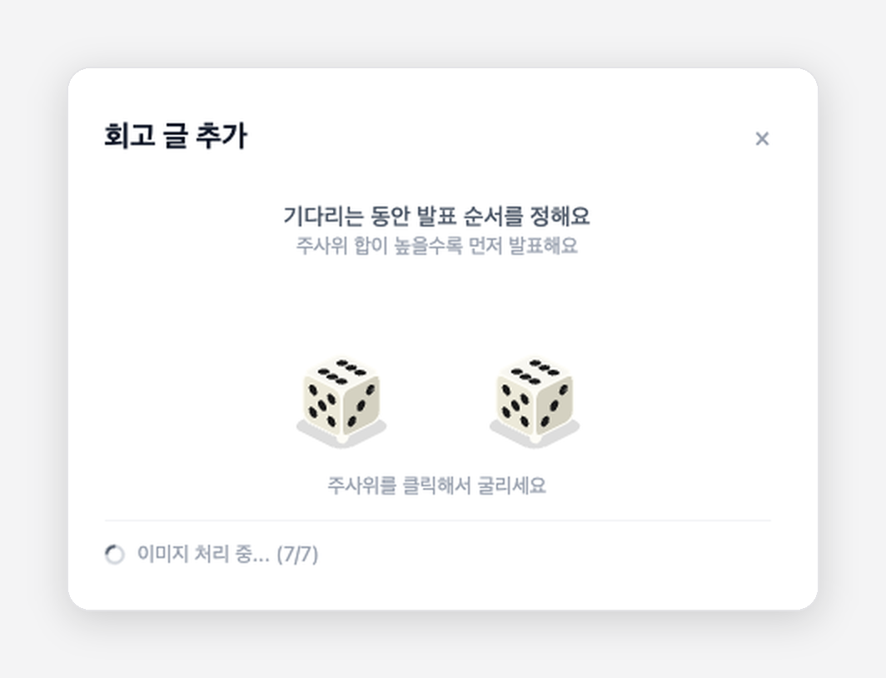
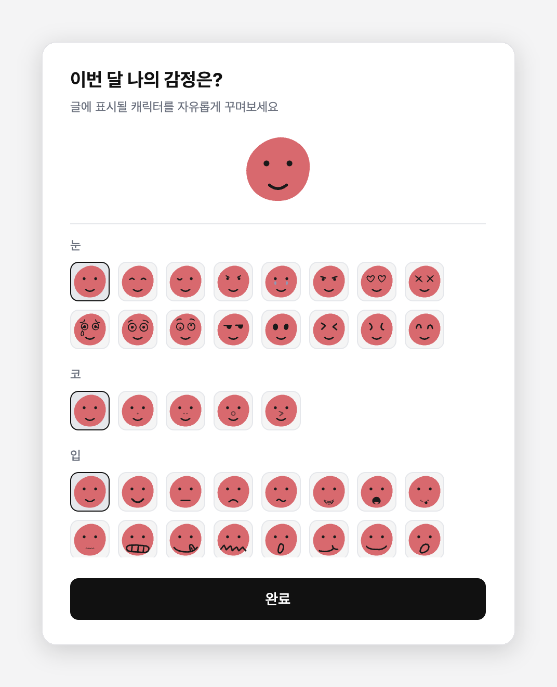
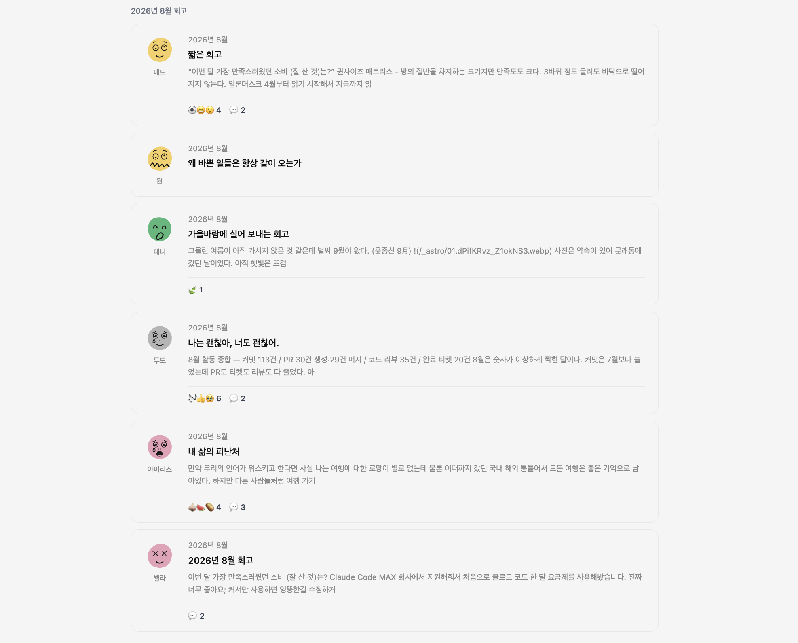

## 들어가며

[CHECKIN](/projects/checkin)은 개발자 월간 회고 모임에서 쓰려고 만든 웹앱이다. 멤버들이 노션이나 블로그에 회고 글을 쓰고 링크를 등록하면, 앱이 본문을 파싱해서 한곳에서 모아 읽을 수 있게 보여준다.

사용자는 회고 멤버 8명. 우리끼리 쓰는 도구라서 운영비는 0원이 목표였다. 그래서 백엔드는 Supabase 무료 플랜을 사용했다. 이 글의 거의 모든 판단은 이 조건에서 시작한다.

문제는 글을 등록할 때 본문 이미지를 어떻게 저장하느냐에서 시작됐다.

## 이미지가 깨지고, 함수가 멈췄다

처음에는 본문에 있는 이미지 URL을 그대로 저장했다. 등록할 땐 멀쩡했는데, 다시 들어가 보니 이미지가 깨져 있었다. 노션 이미지 URL은 몇 시간이면 만료되는 임시 주소였고, 티스토리 이미지도 시간이 지나자 하나둘 깨졌다. 원본 링크에 기대지 않으려면 이미지를 직접 가지고 있어야 했다.

그래서 글을 등록할 때 Edge Function에서 이미지를 내려받아 Supabase Storage에 저장하도록 바꿨다. 이번엔 이미지가 많은 글을 등록하면 등록이 실패했다

[Edge Function 무료 플랜에는 실행 제한](https://supabase.com/docs/guides/functions/limits)이 있다. 워커가 살아 있을 수 있는 시간(wall clock)은 무료 플랜에서 150초이고, 실제로 CPU를 쓰는 시간은 요청당 2초다. 처음 구조에서는 함수 하나가 글에 든 이미지를 전부 내려받아 올렸다. 그러다 보니 외부 이미지 서버 하나만 느려도 함수 전체가 그 응답을 기다렸고, 이미지가 많은 글일수록 한도에 가까워졌다.

그래서 함수 하나가 모든 이미지를 떠안지 않도록, 이미지 한 장당 함수 하나를 호출하게 쪼갰다. 함수 하나가 맡는 일이 이미지 한 장으로 줄었고, 느린 서버가 있어도 그 한 장만 늦어졌다. 한 장이 실패해도 글은 등록됐다.

## 남은 문제: 오랜 기다림

이미지는 더 이상 깨지지 않았다. 대신 등록이 느려졌다. 이미지가 7장쯤 있는 노션 회고 글을 등록하면 7\~10초가 걸렸다. 버튼을 누르고 10초를 가만히 기다리는 건 생각보다 길다.

등록 과정을 정리하면 이렇다.

```
세션 갱신 → 본문 파싱 → [이미지 업로드 × N, 병렬] → URL 교체 → 저장 → 목록 새로고침
```

노션 본문을 파싱하는 데 API를 여러 번 호출해야 하고, 이미지 단계는 병렬이어도 가장 느린 한 장이 끝나야 넘어간다. 큰 사진 하나나 콜드 스타트를 만난 함수 하나가 전체를 붙잡는 식이다.

더 줄일 방법이 없지는 않았다.

- **유료 플랜:** 실행 제한이 넉넉해진다. 하지만 8명이 한 달에 한 번 쓰는 도구에 매달 돈을 내는 건 아무래도 오버 스펙이다.
- **비동기 처리:** 글을 먼저 저장하고, 이미지는 [Supabase Queues](https://supabase.com/docs/guides/queues)로 뒤에서 옮긴 뒤 본문 URL을 바꿔치기하는 방식이다. 사용자는 기다릴 필요가 없고, 실패한 작업은 큐가 다시 시도해 준다.\
  하지만 큐와 스케줄러, 처리 함수가 따로 필요하다. 무엇보다 재시도가 노션 URL 만료보다 늦으면, 처음 겪었던 깨진 이미지 문제로 돌아간다. 파싱을 기다리는 시간도 그대로 남는다.

8명이 쓰는 도구에 들일 복잡도는 아니라고 판단했다. 물론 사용자가 늘거나 등록이 잦아진다면 그때는 비동기 처리를 고려할 수 있겠지만 지금 필요한 건 더 단순하고, 돈이 들지 않는 방법이었다.

## 줄일 수 없다면 질문을 바꾸자

처음에는 등록 버튼을 눌러도 아무 표시가 없었다. 지금 뭐가 진행되고 있는지 알 수 없으니, 멈췄다고 생각하고 창을 닫아버릴 수도 있었다. 그래서 "이미지 처리 중 3/7"처럼 진행 상황을 보여주는 로딩바부터 넣었다.

이제 뭐가 진행 중인지는 알 수 있지만 끝날 때까지 가만히 기다려야 하는 건 그대로였다.

그러다 엘리베이터 거울 이야기가 떠올랐다. 엘리베이터가 느리다는 불만이 계속되자, 엘리베이터를 빠르게 만드는 대신 안에 거울을 달았더니 불만이 줄었다는 이야기다. 기다리는 시간은 그대로인데, 거울을 보느라 덜 지루했던 것이다.

그래서 생각을 바꿨다. **"등록을 어떻게 더 빠르게 만들까"가 아니라, "기다리는 동안 무엇을 하게 할까".**

## 첫 번째 시도: 주사위 굴리기

우리 회고 모임은 순서를 정해서 돌아가며 발표를 한다. 그 순서 정하기를 기다리는 시간에 해 보면 어떨까 싶었다. 글을 등록하면 이미지를 업로드 중이라는 팝업은 그대로 뜨고, 그 안에 주사위 두 개가 나온다. 주사위를 굴리면 두 눈의 합이 발표 순서 점수가 된다.



문제는 주사위가 1\~2초면 끝난다는 것이었다. 주사위는 멈췄는데 로딩은 계속 돌고 있었다.

대기 시간은 이미지 크기와 서버 상태에 따라 매번 다르다. 그런데 주사위는 늘 1\~2초다. 그렇다고 주사위가 구르는 시간을 늘리는 건 억지였다. 길이가 매번 다른 기다림을 채우려면, 길이가 정해지지 않은 무언가가 필요했다.

## 두 번째 시도: 이달의 기분

그렇다면 기다리는 시간의 길이를 사용자가 정할 수 있다면 어떨까? 업로드가 빨리 끝나면 빨리 끝내고, 오래 걸리면 좀 더 머물 수도 있도록. 그리고 단순히 시간을 때우는 게 아니라, 한 달을 돌아보는 회고와 어울리는 것.

그렇게 만든 게 "이달의 기분"이다. 글을 등록하면 "이번 달 나의 감정은?"이라는 화면이 뜬다. 색, 모양, 눈, 코, 입을 골라서 이번 달 내 기분을 닮은 얼굴을 만든다. 색 10종, 모양 4종, 눈 16종, 코 5종, 입 21종. 업로드가 끝날 때까지 충분히 고민할 수 있을 만큼 넉넉하게 준비했다.



업로드가 끝나기 전까지 완료 버튼은 꺼져 있다. 업로드가 끝나도 화면을 자동으로 닫지 않고, 사용자가 직접 완료를 눌러야 나갈 수 있다. **사용자가 시스템을 기다리던 구조를, 시스템이 사용자를 기다리는 구조로 만들었다.**

이렇게 만든 얼굴은 그 달 회고 카드에 프로필 사진 대신 들어간다. 발표 순서는 글을 등록할 때 랜덤으로 정해지도록 바꿨다.

## 결과

8명 모임이라 숫자로 말하기엔 표본이 작다. 그래도 몇 가지는 분명하게 보였다.

- 이달의 기분을 도입한 뒤 등록된 글 22개 중 20개(91%)는 기본 얼굴에서 하나 이상을 바꿨다. 완료 버튼만 누르고 넘어가지 않고, 기다리는 동안 뭔가를 했다는 뜻이다.
- 글 등록이 덜 기다려진다는 피드백을 받았다. **"표정을 만들고 기다림 없이 완료 버튼을 눌렀어요. 업로드를 기다리고 있다는 느낌이 들지 않았습니다"**



## 마치며

처음 질문은 "어떻게 더 빠르게 만들까"였다. 그러다 "기다리는 시간에 무엇을 하게 할까"로 생각을 바꿔봤다. 주어진 조건 안에서 시간을 더 줄일 수 없다면, 문제를 다시 정의하는 것도 하나의 풀이가 될 수 있는 거 같다.

그리고 로딩 화면을 채우려고 만든 기능이 회고를 조금 더 풍성하게 만들었다. 이제 회고 카드에는 글 제목 옆에 각자 고른 얼굴이 있다. 제목과 표정만 봐도 그 사람의 한 달이 어땠는지 조금은 짐작이 간다.
