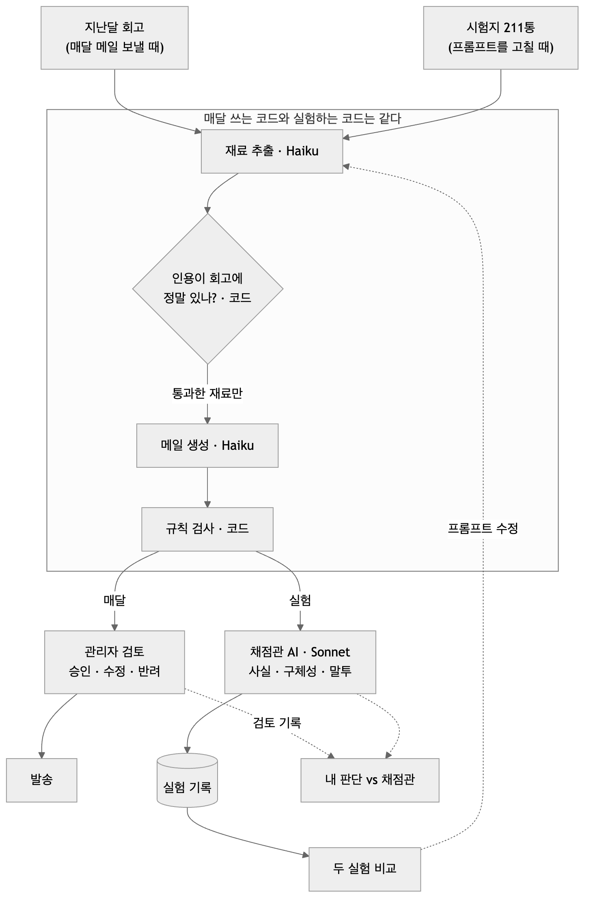
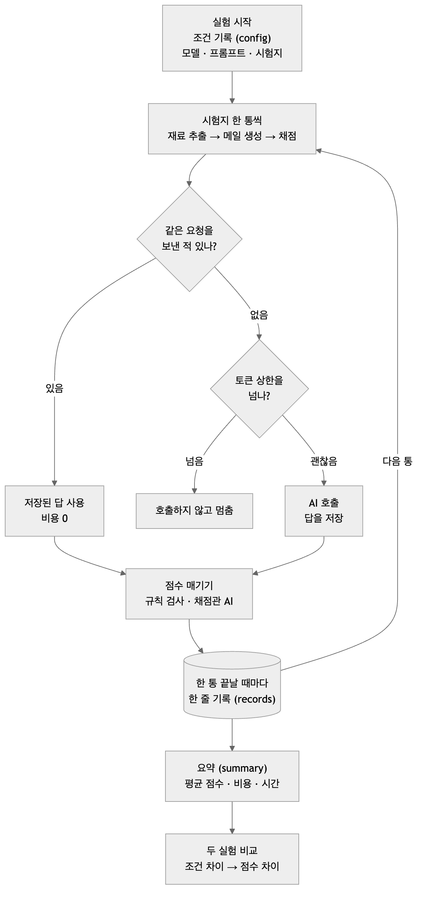
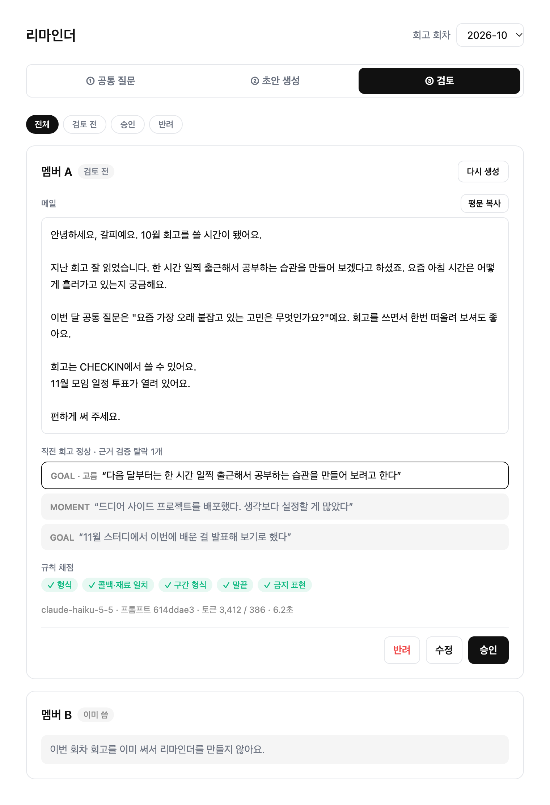
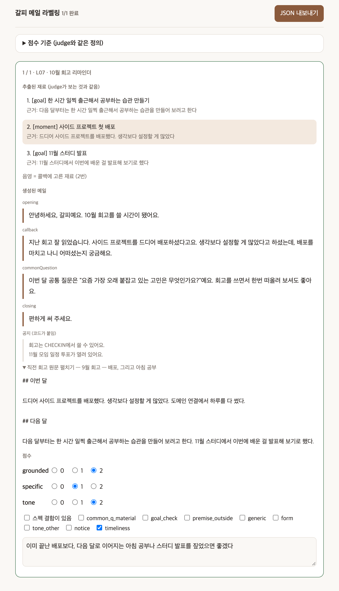
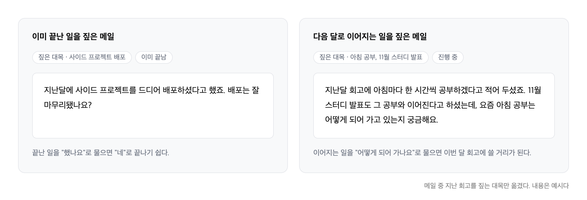
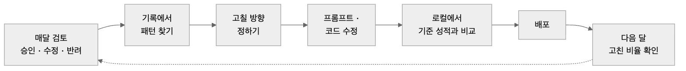

## 들어가며

[CHECKIN](/projects/checkin)은 개발자 월간 회고 모임에서 쓰는 웹앱이다. 사용자는 회고 멤버 7명이다.

모임 전에는 멤버마다 리마인더 메일을 한 통씩 보낸다. 지난달 회고의 한 대목을 짚고, 그 일이 어떻게 되어 가는지 묻는다. 예를 들어 지난달 회고에 "한 시간 일찍 출근해서 공부하기"라는 목표가 있었다면, 요즘 아침 공부는 어떻게 되어 가는지 묻는 식이다.

처음에는 내가 로컬에서 Claude Code로 초안을 만들고 직접 다듬어 보냈다. 그런데 이렇게 하면 프롬프트를 고쳐도 메일이 나아졌는지 알기 어렵고, 내가 무엇을 고쳤는지도 남지 않았다. 매달 같은 일을 손으로 하는 것도 번거로웠다.

그래서 메일 생성을 앱으로 옮겼다. 메일 쓰는 일을 AI에게 맡기고, AI가 쓴 메일이 나아졌는지 잴 수 있는 장치를 함께 만들었다.

## 메일 쓰는 일을 AI에게 맡기려면

목표는 두 가지였다.

- **리마인더 메일 자동화:** 버튼을 누르면 멤버별 초안이 나오고, 나는 읽고 평가하고 고쳐서 보낸다.
- **좋아졌는지 숫자로 말하기:** 프롬프트를 고쳤을 때 메일이 나아졌는지 나빠졌는지 감이 아니라 숫자로 판단한다.

좋은 메일의 조건도 정했다.

- 지난 회고에 없는 말을 지어내지 않는다.
- 누구에게나 보낼 수 있는 말이 아니라, 그 사람에게만 보낼 수 있는 이야기를 한다.
- 말투가 부담스럽지 않다. 했는지 검사하거나 재촉하지 않는다.
- 날짜와 링크는 틀리면 안 된다.

## 전체 구조



메일 한 통은 AI를 두 번 거친다. 먼저 지난달 회고에서 짚을 만한 대목(재료)을 원문 그대로의 인용과 함께 뽑는다. 그 인용이 회고에 정말 있는지는 코드가 확인한다. 통과한 재료만 받아 메일을 쓴다.

AI에게 맡기는 부분은 최대한 줄였다. 메일에는 다음 모임 날짜와 투표 링크가 들어간다. 이걸 AI가 쓰게 하면 어쩌다 틀릴 수도 있다. 그래서 인사나 지난 회고 이야기처럼 '말'이 필요한 부분만 AI가 쓰고, 날짜와 링크는 코드가 붙이도록 했다.

## 어떻게 만들었나

### 시험지부터 만들기

프롬프트를 고칠 때마다 비교하려면 매번 같은 시험지로 시험을 봐야 한다. 시험지는 2023년부터 쌓인 지난 회고로 만들었다. "그때 이 기능이 있었다면 보냈을 메일"을 다시 만들어 보는 것이다. 그렇게 211통 분량이 나왔다. 이 중 40통은 프롬프트를 고칠 때 들여다보는 연습용으로, 나머지 171통은 고친 결과를 확인할 때만 쓰는 확인용으로 나눴다.

메일마다 모범 답안을 써 두지는 않았다. 대신 회고 데이터만 보고 바로 정할 수 있는 것 하나만 표시했다. 이 메일에 지난 회고를 짚는 대목(콜백)이 들어가야 하나, 없어야 하나.

- 지난달 회고 본문이 남아 있다 → 짚을 거리가 있다 → 콜백이 있어야 한다.
- 지난달 글이 비공개로 바뀌었거나 그달에 쓰지 않았다 → 짚을 거리가 없다 → 콜백이 없어야 한다. 여기서 AI가 콜백을 쓰면 지어낸 것이다.

### 채점은 두 가지로

시험지가 준비됐으니, 이제 메일을 쓰는 AI가 잘 쓰는지 잴 방법이 필요했다. 채점은 두 가지로 했다.

하나는 맞춤법 검사기 같은 규칙 검사다. 문장이 몇 개인지, 느낌표나 금지된 표현이 있는지는 코드가 센다. 비용이 들지 않고 결과가 매번 같아서 운영에도 붙였다.

하지만 "이 메일이 정말 이 사람에게만 보낼 수 있는 메일인가"는 코드만으로 확인할 수 없다. 그래서 이 부분은 AI에게 채점을 맡겼다. 메일을 쓰는 AI(Haiku)보다 한 단계 위의 모델(Sonnet)이다.

채점관 AI는 메일마다 세 가지를 0\~2의 점수를 매긴다. 지난 회고에 없는 말을 지어내지 않았는지, 이 사람만의 이야기인지, 말투가 부담스럽지는 않은지. 이유를 먼저 쓰고, 그 이유를 근거로 점수를 쓰게 했다.

```json
// 예시
{
  "grounded": {
    "reason": "재료 2의 인용과 같은 내용이다. 지어낸 사실은 없다.",
    "score": 2
  },
  "specific": {
    "reason": "다음 달 배포 계획이라는 한 대목을 짚고, 질문도 거기서 이어진다.",
    "score": 2
  },
  "tone": {
    "reason": "담백하다. 다만 '꼭'이라는 표현이 재촉처럼 읽힌다.",
    "score": 1
  }
}
```

### 실험 기록 남기기



점수를 비교하려면 실험 자체부터 믿을 수 있어야 했다. 그래서 실험을 기록하는 장치(평가 하네스)를 만들었다. 로컬에서 돌리는 스크립트다.

실험 한 번을 돌리면 폴더 하나가 생긴다. 어떤 모델과 어떤 프롬프트로 돌렸는지, 시험지 한 통마다 AI가 무엇을 썼고 몇 점을 받았는지, 비용과 시간이 얼마나 들었는지가 남는다. 두 실험을 비교할 때는 점수보다 조건을 먼저 본다. 프롬프트가 정말 바뀌었는지, 시험지는 같은지부터 확인해야 점수 차이를 읽을 수 있다.

```
runs/20261102-170742-baseline/
├── config.json     # 모델, 프롬프트 해시, 시험지 해시, 커밋
├── records.jsonl   # 시험지 한 통 × 단계마다 출력, 토큰, 시간, 점수
└── summary.json    # 평균 점수, 토큰, 비용
```

AI 호출은 요청 내용을 통째로 해시해서 저장해 둔다. 같은 요청을 다시 보내면 AI를 부르지 않고 저장된 답을 꺼낸다. 이렇게 하면 채점 기준만 바꿨을 때 메일은 그대로 두고 채점만 다시 할 수 있다.

호출하기 전에는 토큰 수가 정해 둔 상한을 넘는지 먼저 본다. 넘으면 호출하지 않고 멈춘다. 프롬프트를 잘못 고쳐 입력이 불어나도 요금이 새지 않게 하려는 장치다.

### 한 달에 10원

최소 비용으로 운영하고 싶었다. 관리자 화면의 메일 초안 생성과 공통 질문 제안은 가장 저렴한 Haiku API를 쓴다. 채점관 AI는 로컬에서 Claude Code를 통해 부른다. 구독 안에서 돌아서 따로 청구되지 않는다. 같은 채점을 API로 했다면 실험 한 번에 2달러쯤 든다.

매달 API 비용이 나가는 곳은 두 군데다.

- 메일 초안 생성: 재료 추출 + 메일 쓰기, 멤버당 두 번 호출
- 공통 질문 제안: 질문 후보 3개

10월 회차는 다시 생성한 것까지 합쳐 0.5센트가 들었다. 한 달에 10원이 안 된다.

## 어떤 문제가 있었나

### 같은 메일, 다른 점수

AI는 같은 질문에도 매번 조금씩 다르게 답했다. 같은 메일을 두 번 채점시켰더니 점수가 달랐다. 메일을 새로 쓰게 하고 다시 채점하면 더 크게 달라졌다.

그러니 프롬프트를 고친 뒤 점수가 조금 올랐다면, 고쳐서 오른 건지 원래 오르내리는 폭 안에서 우연히 오른 건지 알 수 없다. 그래서 점수를 볼 때마다 이 오르내림의 폭과 견줘 봤다. 항목별 평균 점수(0\~2점)는 같은 조건에서도 ±0.03 안팎으로 오르내렸다. 그 폭보다 커야 진짜 변화로 봤다.

### 업데이트만 했는데 점수가 바뀌었다

개발 중간에 Claude Code를 업데이트했다. 채점관 모델도, 메일도 그대로인데 점수가 바뀌었다. 같은 버전으로 두 번 채점할 때보다 훨씬 많이 바뀌었다. 새 버전이 채점관에게 보내는 내용에 환경 정보를 더 얹고 있었다. 그 뒤로 실험하는 동안에는 버전을 고정했다.

### 채점기가 틀리기도 했다

메일 끝에 질문이 하나 있어야 한다는 규칙 검사에서 통과율이 35%밖에 나오지 않았다. 메일에서는 문제가 없었다. "\~는지 궁금해요"처럼 물음표 없이 묻는 문장을 검사기가 질문으로 치지 않았던 것이다. 검사기만 고치자 메일은 한 글자도 바꾸지 않았는데 통과율이 100%가 됐다.

점수만 보고 AI에게 "물음표를 꼭 붙여라"라고 시켰다면 엉뚱한 곳을 고칠 뻔했다. 점수가 낮을 때는 답이 틀렸는지 채점이 틀렸는지부터 봐야 했다.

## 결과

### 첫 회차



10월 회차를 실제로 돌렸다. 버튼 한 번에 7명분 초안이 30초도 안 걸려 나왔고, 7통을 보냈다. 대부분 내가 조금씩 손을 본 뒤에 나갔다.

고친 곳을 보니 사실이 틀린 메일은 없었다. 주로 표현이나 어떤 대목을 짚었는지였다. 이게 채점관의 점수와도 같은 판단인지 궁금해서, 직접 채점해서 비교해 보기로 했다.

### 나와 채점관을 비교해 봤다



채점관을 믿어도 되는지 알려면 내 판단과 비교해 봐야 했다. 지난 회고를 짚은 메일 27통을 채점관 점수를 가린 채, 같은 세 항목으로 직접 채점했다.

사실이 틀린 메일은 0통이었다. 대신 지난 회고를 짚은 메일 27통 중 11통에 메모를 남겼다. 틀린 말을 해서가 아니었다. "이것보다 더 알맞은 대목이 있었다", "이미 끝난 일이다", "이렇게 물었으면 좋겠다"였다. 이미 끝난 일을 짚으면 대답할 거리가 적다. 다음 달로 이어지는 일을 짚어야 회고에 쓸 거리가 된다.



둘 다 회고에 있는 사실만 말하고, 대목도 구체적이다. 채점관 기준으로는 둘 다 문제가 없다. 그래도 내가 받는다면 두 번째 메일에 할 말이 더 많다.

처음엔 채점관과 내 점수가 잘 맞지 않았다. 그런데 들여다보니 같은 이름으로 다른 걸 재고 있었다. 채점관의 사실 항목은 "고른 재료 안에서 사실만 말하는가"다. 어떤 재료를 골랐는지는 보지 않는다. 나는 재료를 잘못 고른 메일에도 사실 점수를 깎았다.

재료 선택 지적을 사실 점수에서 떼어 따로 세자, 사실은 83\~89%, 말투는 100% 나와 같은 점수였다. 같은 메일을 채점관에게 두 번씩 채점시키고, 메일 묶음 두 개(18통, 9통)에서 각각 비교한 값의 범위다.

구체성은 44~67%였고, 채점관이 나보다 점수를 짜게 주는 쪽이었다. 그런데 이 숫자는 채점관을 다시 돌리기만 해도 같은 18통에서 67%와 56%로 갈렸다. 숫자 자체가 이만큼 흔들리니, 구체성은 전체 평균이 오르는지 내리는지만 참고하고, 메일 한 통 한 통의 판정은 내가 보기로 했다.

### 1.000의 함정

내 점수와 더 잘 맞도록 채점 기준을 조금 고쳤다. 구체성 항목에 "질문이 열려 있어도 그 대목에서 이어진다면 2점"이라는 기준을 추가했고, 내 점수와 맞는 비율은 올라갔다.

그런데 시험지 전체를 다시 채점해 보니, 지난 회고를 짚어야 하는 140통의 구체성 점수가 0.940에서 1.000이 되었다. 140통이 전부 만점이었다. 확인해 보니 내가 매긴 점수가 대부분 2점이었기 때문이었다. 채점관이 모든 메일에 2점을 줘도 나와 맞는 비율은 높게 나온다. 이 기준으로는 잘 쓴 메일과 부족한 메일을 구분할 수 없어서, 원래 기준으로 되돌렸다.

나와 맞는 비율만 볼 게 아니라, 전체를 다시 돌렸을 때 점수가 어떻게 나오는지도 같이 확인해야 한다.

### 정리하면

- 사실을 지어내지 않는지, 말투가 무너지지 않는지는 채점관에게 맡겨도 된다. 프롬프트를 고친 뒤 다른 곳이 망가지지 않았는지 확인하는 데 충분하다.
- 어떤 대목을 짚을지, 그걸 어떻게 물을지는 내가 본다.

## 앞으로

이 구조는 쓸수록 저절로 좋아지지 않는다. AI는 내가 고친 걸 배우지 않는다. 대신 어디를 고쳐야 하는지가 숫자로 보이고, 고친 뒤 나아졌는지 잴 수 있다.



1. 매달 초안을 검토하면 승인·수정·반려와 그 이유가 DB에 쌓인다.
2. 기록을 꺼내 패턴을 찾는다. "이미 끝난 일을 짚었다", "'했나요'보다 '어떻게 되어 가나요'로 물었으면" 같은 것이다.
3. 무엇을 고칠지는 내가 정한다.
4. AI에게 주는 지시문(프롬프트)이나 코드를 고친다.
5. 로컬에서 같은 시험지로 다시 돌려, 지금 쓰는 버전의 성적표와 비교한다. 질문 방식을 고치다 사실을 지어내기 시작하지는 않았는지 본다.
6. 문제없으면 배포한다. 실험한 코드가 그대로 운영 코드다.
7. 다음 달 검토에서 고치는 일이 줄었는지 본다.

다음 차례는 이미 끝난 일보다 다음 달로 이어지는 일을 짚게 하는 것, 그리고 했는지 묻기보다 어떻게 되어 가는지 묻게 하는 것이다. 어떤 대목을 짚었는지는 채점관이 볼 수 없는 영역이라, 고친 뒤에 다시 내가 채점해서 잰다.
